# GreenTrace: technical deep dive

This document explains how GreenTrace works internally: components, data flow, state machines,
the database, the calculation engine, concurrency, failure handling and deployment. It is the
technical companion to the [README](../README.md). The diagrams are [Mermaid](https://mermaid.js.org)
and render automatically on GitHub; in VS Code use a Mermaid preview extension.

Contents

1. [System context](#1-system-context)
2. [Backend layers](#2-backend-layers)
3. [Request lifecycle](#3-request-lifecycle)
4. [Bill processing pipeline](#4-bill-processing-pipeline)
5. [Bill state machine](#5-bill-state-machine)
6. [The LLM extraction layer](#6-the-llm-extraction-layer)
7. [Validation engine](#7-validation-engine)
8. [Review workflow and concurrency control](#8-review-workflow-and-concurrency-control)
9. [Calculation engine](#9-calculation-engine)
10. [Emission-factor selection](#10-emission-factor-selection)
11. [Recalculation and immutability](#11-recalculation-and-immutability)
12. [Database schema](#12-database-schema)
13. [Report generation and verification](#13-report-generation-and-verification)
14. [Authentication and multi-tenancy](#14-authentication-and-multi-tenancy)
15. [Storage](#15-storage)
16. [Frontend architecture](#16-frontend-architecture)
17. [Concurrency, transactions and failure handling](#17-concurrency-transactions-and-failure-handling)
18. [Deployment topology](#18-deployment-topology)
19. [Design decisions and trade-offs](#19-design-decisions-and-trade-offs)

---

## 1. System context

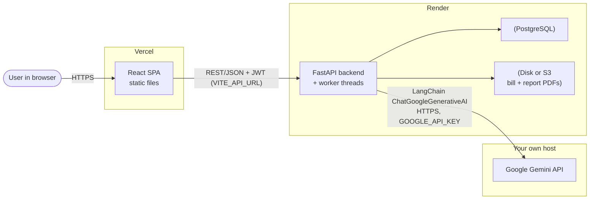

Everything the browser needs is static (Vercel); all logic and data live in the backend. The LLM
is a separate service so it can be sized (GPU/RAM) independently and swapped by changing
`GOOGLE_API_KEY` / `LLM_MODEL`.

---

## 2. Backend layers

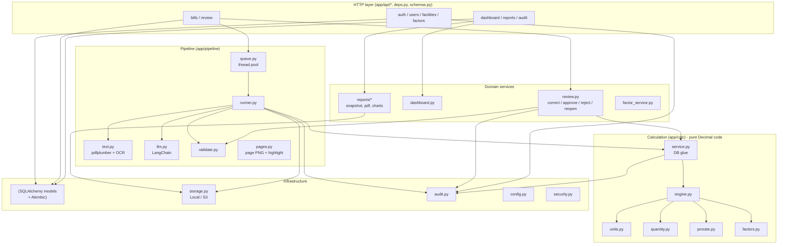

Layering rules that keep the code testable:

- **`app/calc/engine.py`, `factors.py`, `prorate.py`, `quantity.py`, `units.py` never touch the
  database.** They take plain dataclasses and return plain dataclasses. Only `calc/service.py`
  loads/stores rows.
- **`pipeline/validate.py` is pure.** Everything it needs from the database (account mapping,
  overlapping bills, usage history) is gathered by `runner.build_context()` into a
  `ValidationContext` and passed in.
- **The LLM is behind a one-method interface** (`Extractor.extract(text, correction) -> str`), so tests
  inject a scripted fake.
- **Storage is behind an interface** (`save`, `save_file`, `read`).

---

## 3. Request lifecycle

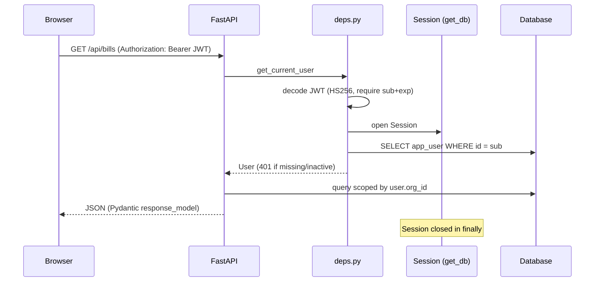

- One SQLAlchemy `Session` per request (`db.get_db` generator dependency), closed when the request ends.
- Handlers `commit()` explicitly; if a handler raises, nothing is committed. The audit row is added to
  the same session, so **a change and its audit record commit or roll back together**.
- Admin-only routes depend on `AdminUser` (`require_admin`), returning 403 for members.
- CORS: `CORSMiddleware` allows any origin without credentials. This is safe because auth is a Bearer token
  in the `Authorization` header, never a cookie. It exposes `X-Page-Count`/`X-Highlight` so the browser can read them.

---

## 4. Bill processing pipeline

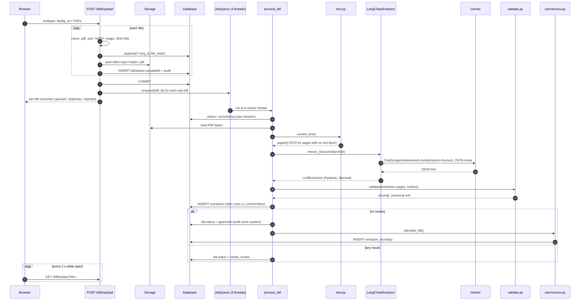

Details worth knowing:

- **The request returns before any AI work.** Upload only stores files and rows. The browser polls a
  lightweight status endpoint.
- **Idempotent claim.** `process_bill` returns immediately unless the bill is `uploaded`/`processing`,
  so a bill is never processed twice by accident.
- **Separate sessions.** The worker opens short sessions: one to mark `processing` (committed before the
  slow LLM call so the UI sees it), another to store the result. No DB transaction is held open during
  the LLM call.
- **Restart recovery.** On startup (`lifespan` in `main.py`) every `uploaded`/`processing` bill is reset to
  `uploaded` and re-enqueued.
- **Failure isolation.** `process_bill` catches `PipelineError` (readable message) and any other exception
  (logged with a reference id, generic message) and marks only that bill `failed`.

---

## 5. Bill state machine

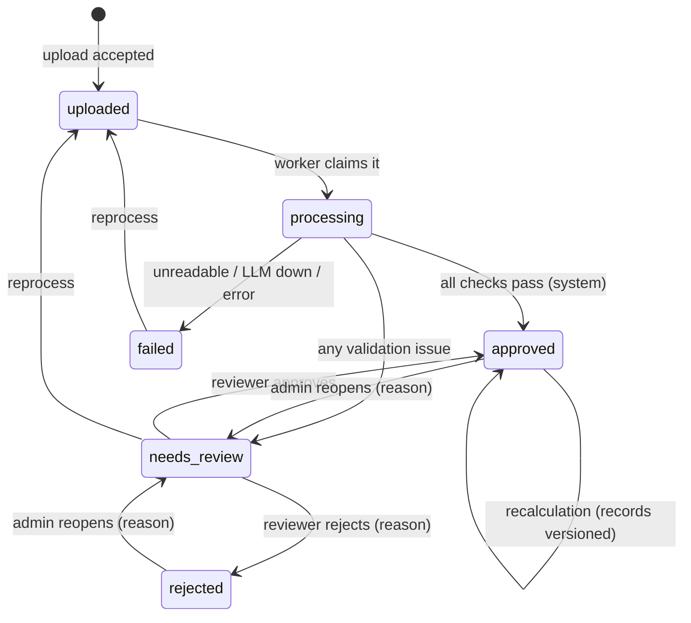

Only `approved` bills have current `emission_record`s. Moving a bill out of `approved` (reopen) or into
`rejected` calls `calculate_bill`, which **retires** the bill's records (`is_current=false`), so totals drop
immediately and consistently.

---

## 6. The LLM extraction layer

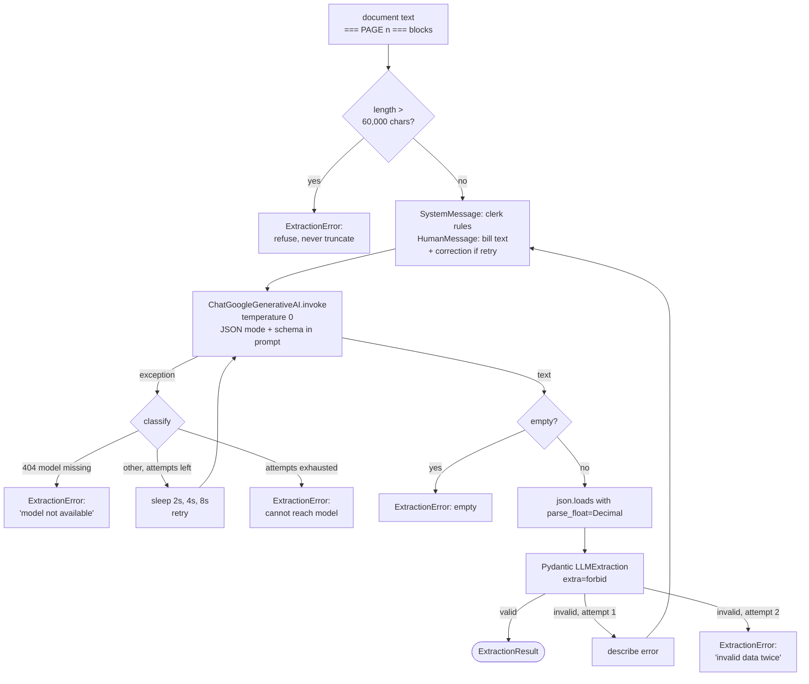

Why this design:

- **Two independent retry loops.** The inner loop (in `LangChainExtractor.extract`) handles *transport*
  problems. The outer loop (`extract_structured`) handles *content* problems: it re-asks once and passes
  the exact validation errors back to the model.
- **JSON mode + schema in the prompt.** Gemini runs with `response_mime_type=application/json` and the schema
  is included in the prompt, which sharply reduces malformed output (Pydantic still validates and retries once). The schema is hand-maintained (flat,
  no `$ref`) because providers support only a subset of JSON Schema; a unit test asserts it matches the
  Pydantic model field-for-field.
- **Exact decimals.** `json.loads(..., parse_float=Decimal)` means `1234.56` never passes through a binary
  float. Reviewer input is sent as strings for the same reason.
- **Prompt discipline.** The model is told to copy, not compute. If only meter readings are printed it
  must leave `quantity` null; the arithmetic happens in `calc/quantity.py`.

---

## 7. Validation engine

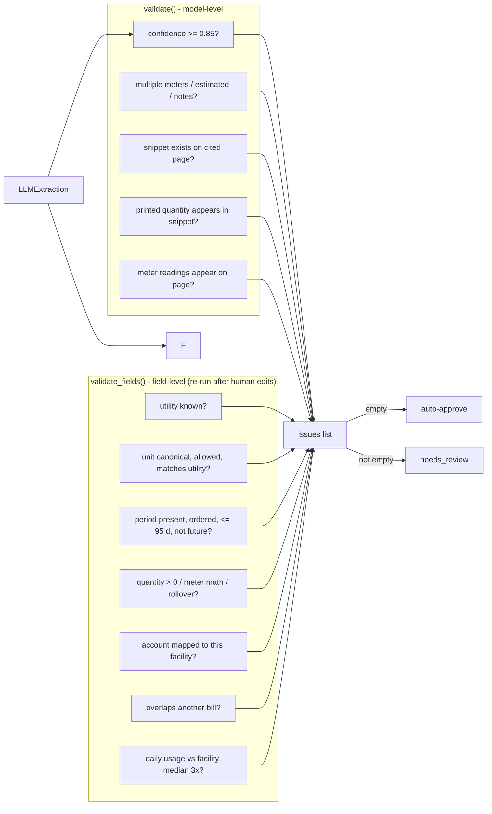

- Each issue is `{code, message, field}`. Codes are split into **BLOCKING** (cannot calculate: reviewer
  must fix) and warnings (acknowledged on approval), and into **LLM_LEVEL** codes (about how the model
  read the PDF; stored once, kept as history) vs field codes (recomputed after every correction).
- `ValidationContext` carries DB-derived facts: the facility an account is mapped to, IDs of overlapping
  bills (period intersection `a.start <= b.end and b.start <= a.end`), and `HistoryPoint`s (quantity, unit,
  days) of earlier approved bills for the outlier median.
- **Outlier maths:** every historic bill is converted to a base unit (MJ for energy, m³ for volume), divided
  by its days to get a daily rate; the new bill's daily rate divided by the median must lie within
  `[1/3, 3]`. Needs at least 3 comparable bills.
- **Hallucination guard:** `_normalize` collapses whitespace and lowercases; the snippet must be a
  substring of the cited page. `_numbers_in` extracts numbers (commas stripped, as `Decimal`) and the
  extracted quantity must be among them.

---

## 8. Review workflow and concurrency control

```mermaid
sequenceDiagram
    participant R as Reviewer (browser)
    participant API as /extractions/{id}/approve
    participant RV as review.py
    participant V as validate_fields
    participant CS as calc/service
    participant DB as Database

    R->>API: changes{...}, expected_updated_at, remap_account?, note
    API->>RV: load_for_review()
    RV->>DB: SELECT extraction, bill (org check)
    RV-->>API: 409 if extraction not current or bill.updated_at != expected
    API->>RV: apply_corrections()
    RV->>DB: update fields; corrections_json keeps ORIGINAL 'before'
    RV->>V: revalidate (keeps LLM-level issues)
    API->>RV: approve()
    RV->>V: revalidate again
    alt blocking issue
      RV-->>R: 422 with the blocking issues
    else account belongs to another facility and not confirmed
      RV-->>R: 409 account_other_facility
    else ok
      RV->>DB: upsert facility_account mapping
      RV->>DB: bill.status=approved, reviewed_by/at, audit(acknowledged_issues)
      RV->>CS: calculate_bill()
    end
    API->>DB: COMMIT (correction + approval + calculation atomically)
```

**Optimistic concurrency:** the client sends the `updated_at` it loaded. If another reviewer changed the
bill meanwhile, the server returns 409 "reload" rather than overwriting. This avoids row locks and keeps
long reviews safe.

**Provenance of corrections:** `corrections_json[field] = {before: <what the AI read>, after: <latest>}`;
if a field is corrected back to the AI's original value, the entry is removed. Each change is also an
audit row with the reviewer and reason.

---

## 9. Calculation engine

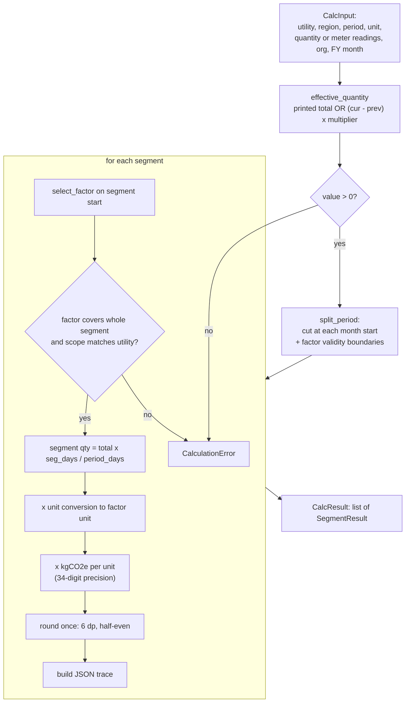

Key properties:

- **Types:** all inputs are `Decimal`; `calculate()` raises `TypeError` on floats. Context precision is 34
  significant digits for intermediate values; results are quantized to `0.000001` kg (1 mg) with
  `ROUND_HALF_EVEN`. Day fractions are stored to 12 decimals but the *math uses exact `days/total`*, not the
  rounded fraction.
- **Why split on months:** each emission record then belongs to exactly one month and one reporting year, so
  dashboard sums by month/year are exact and a period boundary never cuts a record. Splitting also at factor
  validity boundaries means a bill straddling two factor editions uses each factor for the right days.
- **Scope:** electricity → 2 (location-based), natural gas → 1; the factor's scope must agree.
- **Trace:** each segment stores quantity (with source `printed`/`meter_readings`), allocation (fraction,
  method, reporting year), normalization (multiplier + the constants' definitions), the complete factor
  record (key, version, source, derivation), a human-readable formula string, and the result. A reviewer or
  auditor can recompute it by hand.

**Worked example** - Pune plant, 16 Mar to 15 Apr 2024, 12,400 kWh printed (illustrative):

| Segment | Days | Quantity | Factor | kg CO2 |
|---|---|---|---|---|
| 16-31 Mar (FY2023-24) | 16 | 12,400 × 16/31 = 6,400 kWh = 6.4 MWh | 727 kg/MWh | 4,652.8 |
| 1-15 Apr (FY2024-25) | 15 | 12,400 × 15/31 = 6,000 kWh = 6.0 MWh | 710 kg/MWh | 4,260.0 |

Two `emission_record`s; the FY2023-24 report contains only the first.

---

## 10. Emission-factor selection

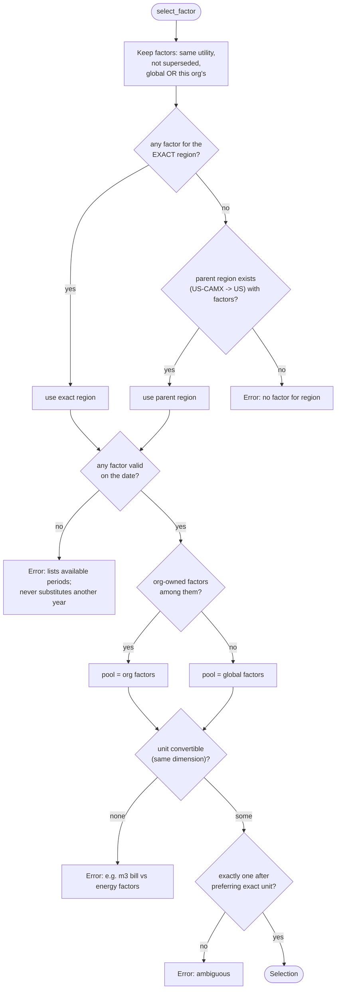

The principle is **fail loudly rather than guess**. An approved bill that hits one of these errors is stored
with `calculation_error`, contributes nothing, and is counted in the dashboard's completeness banner until a
factor is added and recalculation runs.

---

## 11. Recalculation and immutability

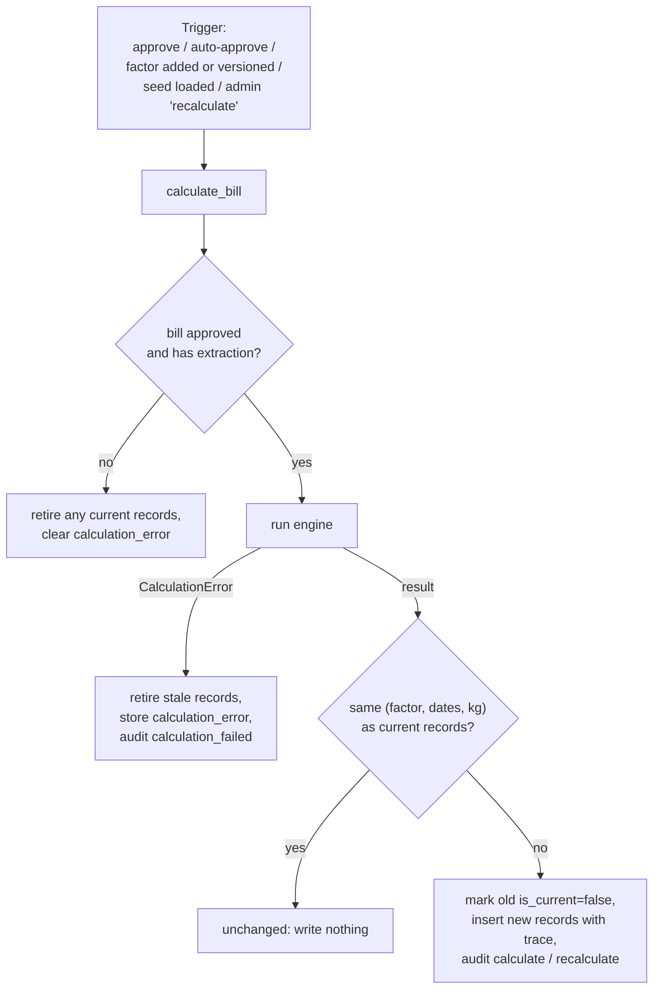

Records and factors are **append-only**: nothing is edited or deleted. History stays queryable
(`GET /bills/{id}/trace` returns `superseded_records`). The no-op comparison makes the operation idempotent,
so running "recalculate" repeatedly is safe and doesn't spam the audit log.

---

## 12. Database schema

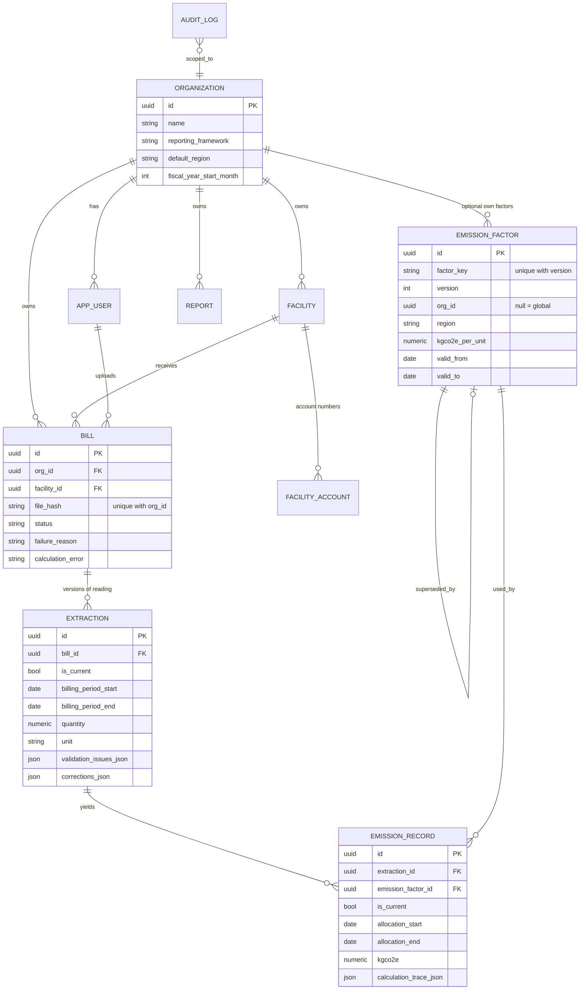

- **Portable types** (`models/base.py`): `JSON` that becomes `JSONB` on Postgres; `Numeric(20,6)` for
  quantities/kg and `Numeric(24,12)` for factors; UUID primary keys generated in Python.
- **Constraints that encode rules:** `uq_bill_org_hash` (a file can be uploaded once per org),
  `uq_factor_key_version`, `uq_facility_org_name`, `uq_facility_account (org, utility, account)`.
- **Migrations:** Alembic (`0001` schema, `0002` `bill.calculation_error`, `0003` report hashes + draft flag).
  A test fails if models drift from migrations. The service runs `alembic upgrade head` on every start.
- **SQLite vs Postgres:** tests and local dev use SQLite (foreign keys enabled by a connection event);
  production uses Postgres (`pool_pre_ping=True`). `DATABASE_URL` normalisation converts `postgres://` and
  `postgresql://` to `postgresql+psycopg://` (psycopg v3).

---

## 13. Report generation and verification

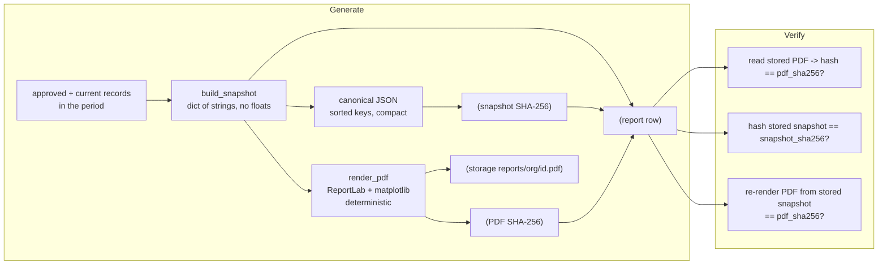

- **Snapshot-first design:** the PDF is a pure function of the snapshot. Live data is read once, at generation.
- **Determinism:** `canonical_json` uses sorted keys and fixed separators; ReportLab runs with
  `invariant=1` (no timestamps/random ids); matplotlib is configured with a fixed hash salt and no date
  metadata. So `render_pdf(snapshot)` produces identical bytes, which is what makes the third check meaningful.
- **Draft logic:** `status_counts` finds bills that may belong to the period but aren't included. If any,
  the report is a `DRAFT` (watermark, cover text, `-DRAFT` filename).
- **Pinned libraries:** byte-identical rendering assumes the same ReportLab/matplotlib versions, which is
  why `requirements.txt` pins exact versions.

---

## 14. Authentication and multi-tenancy

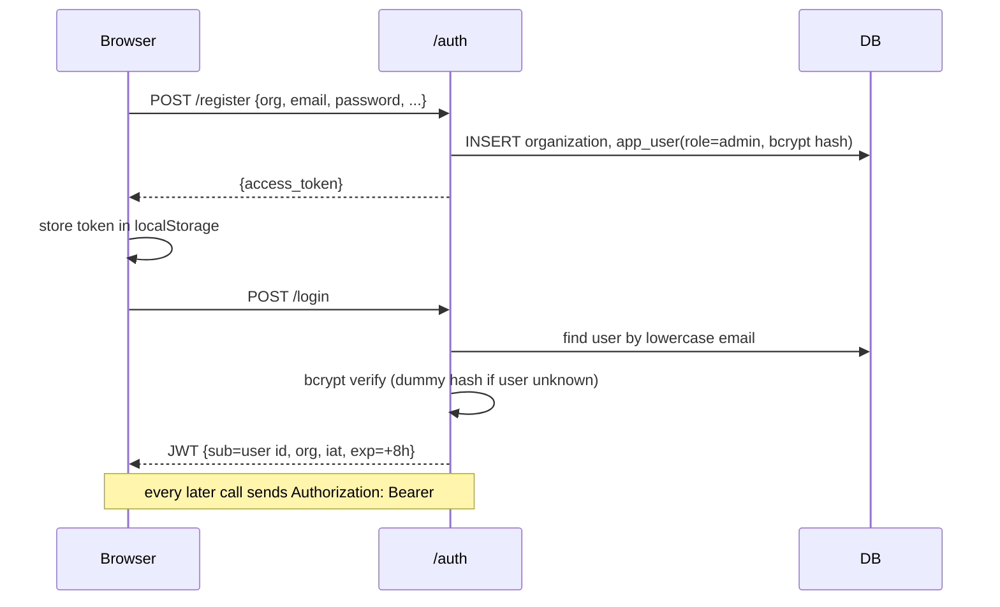

- **JWT**: HS256, signed with `JWT_SECRET`. If unset, a 48-byte random secret is generated once and saved to
  `<STORAGE_DIR>/.jwt_secret` (mode 0600 where supported). On a read-only filesystem it falls back to a
  per-process secret (logins end on restart).
- **Passwords**: bcrypt with per-hash salt; ≥10 characters enforced by the request model.
- **Tenant isolation is by query scoping, not by URL secrecy.** Every router filters by `user.org_id`
  (`get_org_bill`, `get_org_facility`, …); a foreign id yields 404 so existence isn't leaked.
- **Roles:** `admin` vs `member` via `require_admin`. The first user of an organization is an admin.

---

## 15. Storage

`storage.py` defines `Storage` with `save(org_id, hash, bytes)`, `save_file(key, bytes)`, `read(key)`.

- **Keys are generated server-side** from a UUID and a hex digest (`bills/<org>/<hash>.pdf`,
  `reports/<org>/<report>.pdf`); `_check_key` rejects absolute paths, backslashes, control characters and
  `..` segments, and `LocalStorage` additionally verifies the resolved path stays under its root.
- **Content-addressed bills:** the key contains the SHA-256, so identical bytes map to the same object.
- **`LocalStorage`** writes under `STORAGE_DIR`; **`S3Storage`** (boto3, path-style addressing, 5 retries)
  works with AWS S3, MinIO and Supabase Storage. Buckets must stay private; files are only served via the API.

---

## 16. Frontend architecture

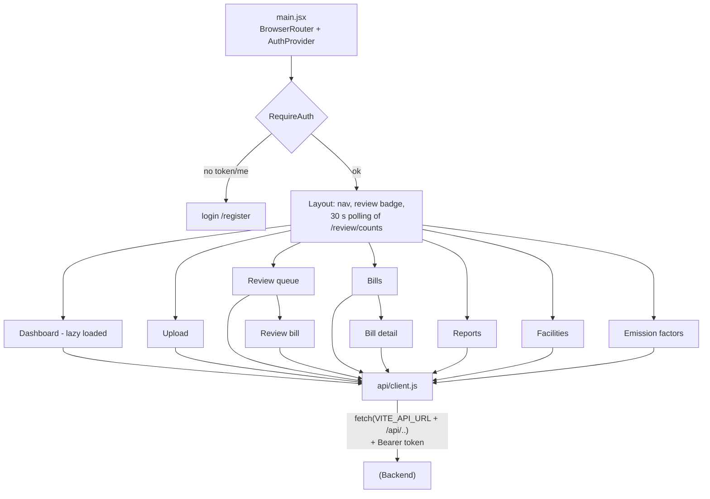

- **State:** local React state + `useEffect` fetches; no global store beyond `AuthProvider` (current user/org).
- **`api/client.js`** centralises base URL, the `Authorization` header, JSON/FormData handling, and an
  `ApiError` that formats FastAPI's string or validation-error list. `fetchBlobUrl`/`fetchPage` fetch PDFs/PNGs
  with the token and turn them into object URLs (an `<iframe>` can't send headers).
- **Dev vs prod:** in dev, Vite proxies `/api` to `localhost:8000` (so `VITE_API_URL` is empty). In production
  the build is static and `VITE_API_URL` is baked in at build time.
- **Performance:** Recharts is code-split (`React.lazy`) so only the dashboard downloads it.
- **Precision:** the UI never does emission maths; it displays strings the server already rounded, and sends
  edited numbers back as strings.

---

## 17. Concurrency, transactions and failure handling

| Concern | Mechanism |
|---|---|
| Slow AI calls blocking requests | Upload returns immediately; `ThreadPoolExecutor(3)` processes bills. |
| Limiting LLM load | Pool size = max concurrent LLM calls (`EXTRACTION_WORKERS`). |
| Double processing | `process_bill` only acts on `uploaded`/`processing` bills. |
| Server restart mid-job | Startup re-queues unfinished bills. |
| One bad bill | Errors caught per bill → `failed` + reason; others continue. |
| LLM down | 4 attempts with backoff, then a readable failure; **Reprocess** later. |
| Atomic changes | Domain change + audit row share one transaction; handlers commit once. |
| Two reviewers, one bill | Optimistic check on `updated_at` → 409. |
| Duplicate uploads | SHA-256 + unique constraint `(org_id, file_hash)`. |
| Stale numbers in totals | Retire-and-replace of records, never edit in place. |
| Float error | `Decimal` end-to-end; strings in JSON and the snapshot. |
| Tampering with reports | Snapshot + PDF hashes and byte-identical re-render. |

Limitation: the queue is in-process memory, which is correct for **one** API instance. With several
instances you would add a shared broker (Redis + RQ/Celery); `JobQueue.enqueue` is the only call site to change.

---

## 18. Deployment topology

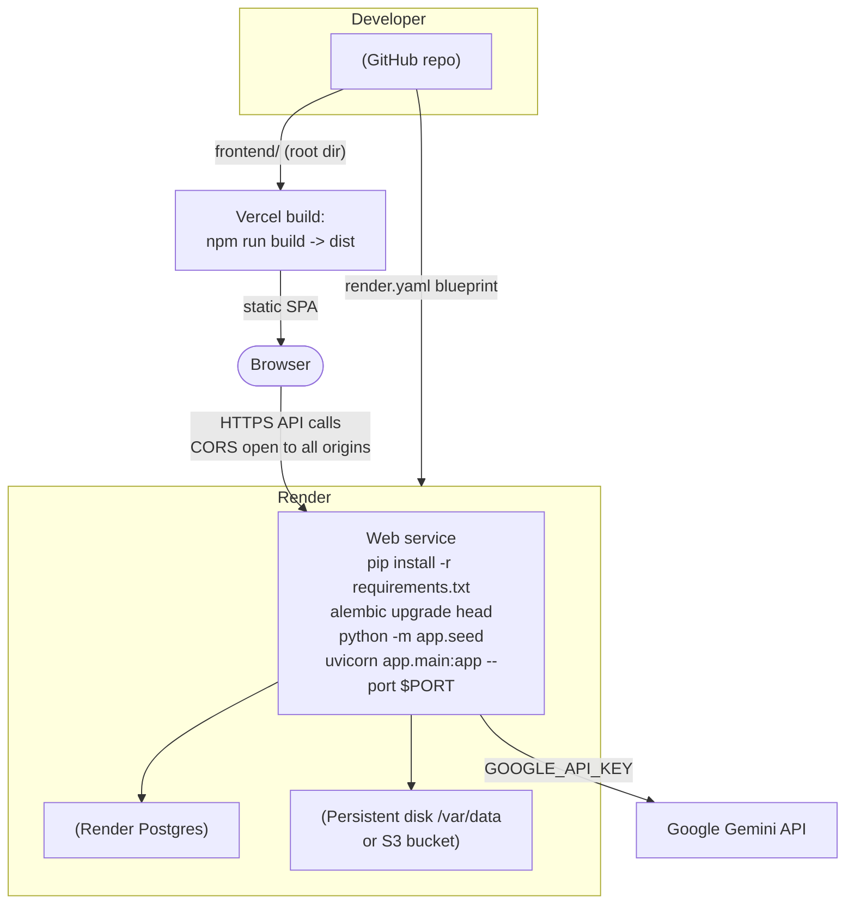

Environment configuration at a glance:

| Where | Variable | Purpose |
|---|---|---|
| Vercel | `VITE_API_URL` | Backend origin baked into the frontend build. |
| Render (auto) | `DATABASE_URL`, `JWT_SECRET`, `PYTHON_VERSION`, `STORAGE_DIR` | From `render.yaml`. |
| Render (you) | `GOOGLE_API_KEY` | Your Gemini key. |
| Optional | `STORAGE_BACKEND=s3` + `S3_*` | Durable storage on the free tier. |

There is no `.env` file anywhere and no LLM API key; configuration is code defaults plus platform variables.

---

## 19. Design decisions and trade-offs

| Decision | Reason | Cost / alternative |
|---|---|---|
| LLM only extracts; code calculates | Reproducible, auditable maths; the model can't silently change a total. | Needs a strict schema and validation layer. |
| Everything uncertain goes to human review | Safer than trusting the model. | More review work with a weaker model. |
| Validation that the quote exists on the page | Cheap, strong defence against hallucinated numbers. | OCR layout differences can trigger review. |
| Append-only records & factors | Full history; old reports stay explainable. | More rows; queries filter `is_current`. |
| Split bills at month and factor boundaries | Exact monthly/yearly totals, correct factor per day. | Assumes uniform daily consumption. |
| Fail instead of guessing a factor/unit | No silent wrong numbers. | Needs factor data kept up to date. |
| `Decimal` and strings everywhere | No float drift between UI, DB, PDF. | Slightly more code. |
| Snapshot-first, deterministic PDF + hashes | Verifiable, tamper-evident reports. | Pinned library versions. |
| In-process thread-pool queue | Simple, no extra infra for one instance. | Not horizontally scalable without a broker. |
| Gemini via LangChain | Nothing to host, strong accuracy, and vision doubles as OCR; swap models by name. | Needs an API key; free tier is rate-limited (the app spaces its calls). |
| SQLite for tests, Postgres for prod | Fast tests, no setup. | Dialect differences must be watched (portable types used). |
| Static SPA on Vercel + API on Render | Cheap, independent scaling and deploys. | Two deployments (CORS is open, since auth is a header token). |
